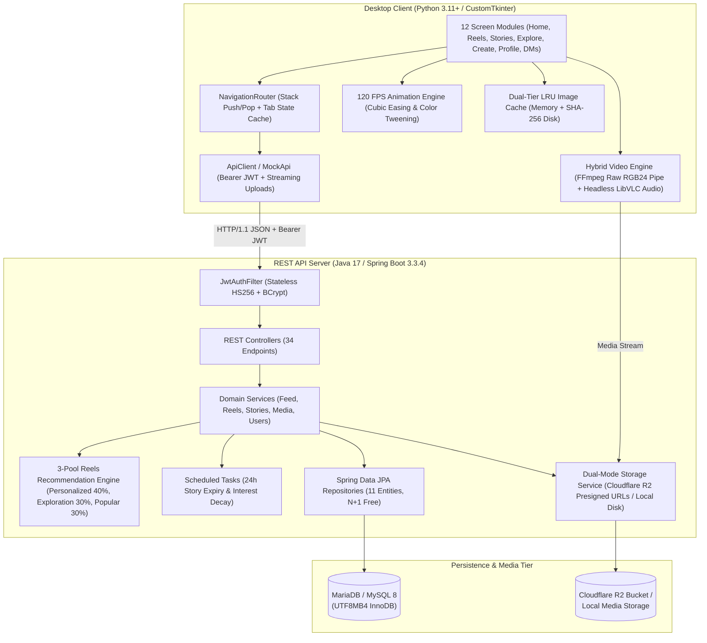

# SocialApp — Full-Stack Multimedia Social Platform

**SocialApp** is a full-stack Instagram-style multimedia social platform composed of a **Java 17 / Spring Boot 3.3.4** REST API backend and a native **Python 3 / CustomTkinter** desktop client. It features an engagement-weighted 3-pool Reels recommendation engine, 24-hour ephemeral Stories, dual-mode object storage (Cloudflare R2 + Local Filesystem fallback), stateless HS256 JWT authentication, a 120 FPS UI animation engine, and a hardware-decoupled **FFmpeg + LibVLC** video playback pipeline.

---

## Table of Contents

1. [System Architecture](#1-system-architecture)
2. [Tech Stack](#2-tech-stack)
3. [Repository Structure](#3-repository-structure)
4. [Quick Start Guide](#4-quick-start-guide)
5. [Core Features & Subsystems](#5-core-features--subsystems)
6. [Environment & Security Configuration](#6-environment--security-configuration)
7. [Demo Accounts](#7-demo-accounts)
8. [Testing & Verification](#8-testing--verification)

---

## 1. System Architecture



---

## 2. Tech Stack

| Layer | Technology | Purpose |
| :--- | :--- | :--- |
| **Backend Runtime** | Java 17+ (OpenJDK 17 / 21 / 25) | Strongly-typed server runtime |
| **Backend Framework** | Spring Boot 3.3.4 | REST API, Spring Security, Spring Data JPA, Validation |
| **Database** | MariaDB 11 / MySQL 8 (Prod), H2 (Tests) | Relational persistence (`utf8mb4_unicode_ci`) |
| **Authentication** | JJWT `0.12.5` (HS256) + BCrypt | Stateless token auth & password hashing |
| **Object Storage** | AWS SDK v2 (`S3Client` / `S3Presigner`) | Cloudflare R2 presigned PUT uploads & local disk fallback |
| **Desktop Client** | Python 3.11+ & CustomTkinter 6.0.0 | Responsive modern dark/light desktop GUI |
| **Video Engine** | FFmpeg (`rawvideo` RGB24) + `python-vlc` | Wayland/X11-safe frame rendering + synced looped audio |
| **Image Pipeline** | Pillow (PIL) | Lanczos downsampling, circular avatar masks, rounded corners |

---

## 3. Repository Structure

```text
.
├── backend/                        # Spring Boot 3.3.4 REST API Server
│   ├── src/main/java/com/socialapp/
│   │   ├── config/                 # Security, CORS, Async, Storage & Recommendation configs
│   │   ├── controller/             # 9 REST Controllers (34 total endpoints)
│   │   ├── dto/                    # Request/Response DTOs & standardized error models
│   │   ├── entity/                 # 11 JPA/Hibernate relational entities
│   │   ├── exception/              # Global @RestControllerAdvice exception handler
│   │   ├── repository/             # Spring Data JPA repositories with batch queries
│   │   ├── security/               # JwtAuthFilter, JwtTokenProvider, CurrentUser resolver
│   │   ├── seed/                   # DataSeeder (6 demo users + 24 posts/reels/stories)
│   │   ├── service/                # Core domain logic, R2/Local storage, FFmpeg thumbnails
│   │   └── util/                   # Hashtag extractor & Media URL builder
│   ├── src/test/                   # 98 JUnit 5 + MockMvc integration & security tests
│   ├── media-storage/              # Local storage directory for avatars, posts, reels & stories
│   ├── schema.sql                  # Full MySQL/MariaDB DDL schema
│   ├── setup-db.sql                # Database and user provisioning script
│   ├── .env.example                # Environment variable template
│   └── README.md                   # Detailed backend API documentation
│
├── frontend/                       # Python CustomTkinter Desktop Client
│   ├── screens/                    # 12 UI screen & modal modules
│   │   ├── login.py                # Auth login & registration screen
│   │   ├── home.py                 # Stories tray + infinite-scroll post feed
│   │   ├── reels.py                # 9:16 vertical video feed + watch-time telemetry
│   │   ├── stories.py              # Fullscreen ephemeral stories viewer modal
│   │   ├── explore.py              # Tag/user search + 3-column media discovery grid
│   │   ├── create.py               # Post/Reel/Story uploader with live hashtag chips
│   │   ├── profile.py              # User profile, follow/unfollow, Posts/Reels grid
│   │   ├── messages.py             # Direct Messaging threads & chat view
│   │   ├── activity.py             # Follow requests & notifications feed
│   │   ├── settings.py             # Theme switcher, privacy, password & cache manager
│   │   ├── comments.py             # Comments modal dialog
│   │   └── follow_list.py          # Followers / Following modal dialog
│   ├── anim.py                     # 120 FPS animation & cubic easing engine
│   ├── api.py                      # HTTP REST client with JWT interceptor
│   ├── async_utils.py              # ThreadPoolExecutor + main-thread queue pump
│   ├── cache.py                    # Two-tier memory LRU + SHA-256 disk image cache
│   ├── config.py                   # Client configuration & backend reachability probe
│   ├── main.py                     # Application entry point, chrome & window manager
│   ├── mock_api.py                 # 100% offline mock API backend
│   ├── nav.py                      # Stack-based navigation router
│   ├── player.py                   # Hybrid FFmpeg + headless LibVLC media player
│   ├── theme.py                    # Typography, color palettes & geometry tokens
│   ├── widgets.py                  # Reusable components (PostCard, StoryRing, Toast)
│   └── README.md                   # Detailed frontend documentation
│
└── tests/e2e/                      # End-to-End multi-tier integration test suites
```

---

## 4. Quick Start Guide

### Prerequisites
- **JDK 17+** (`java -version`)
- **MariaDB 10.6+ or MySQL 8.0+**
- **Python 3.11+** with `tkinter`
- **FFmpeg** & **VLC** installed on system `PATH`

### Step 1: Provision the Database
```bash
sudo mariadb < backend/setup-db.sql
```
*(Creates the `socialapp` database and `socialapp` user on `localhost:3306`).*

### Step 2: Start the Spring Boot Backend
```bash
cd backend
cp .env.example .env   # Optional: customize JWT_SECRET or Cloudflare R2 keys
./mvnw spring-boot:run
```
The server starts on `http://localhost:8080` and automatically seeds demo users, posts, reels, and stories on first boot.

### Step 3: Launch the Desktop Client
```bash
cd frontend
python3 -m venv .venv
./.venv/bin/pip install -r requirements.txt
./.venv/bin/python main.py
```

> **Offline Demo Mode**: You can also run the desktop client without the backend server by passing `--mock` or setting `USE_MOCK=1`:
> ```bash
> USE_MOCK=1 ./frontend/.venv/bin/python -m frontend.main
> ```

---

## 5. Core Features & Subsystems

- **3-Pool Reels Recommendation Engine**:
  Blends **Personalized (40%)**, **Exploration (30%)**, and **Popular (30%)** candidate pools using user hashtag affinity scores (`UserInterest`), watch-time completion telemetry (`POST /api/media/{id}/view`), exponential time decay, and creator anti-clumping rules.
- **Wayland/X11-Safe Hybrid Video Pipeline**:
  Decodes video frames in software via an `ffmpeg` RGB24 pipe rendered directly onto a Tkinter surface while delegating audio looping and volume control to a headless LibVLC instance (`--no-video`). This prevents XWayland/NVIDIA OpenGL black-screen issues and allows CustomTkinter overlay controls to sit cleanly over playing video.
- **120 FPS UI Animation Engine**:
  Custom frame scheduler (`8ms` tick) driving smooth cubic-bezier screen slide transitions, button hover color interpolation, and heart-like bounce animations.
- **Dual-Mode Storage Engine**:
  Supports direct-to-cloud presigned PUT uploads via **Cloudflare R2** (`STORAGE_MODE=r2`) or zero-config local disk storage (`STORAGE_MODE=local`) with automatic FFmpeg video thumbnail extraction.
- **24-Hour Ephemeral Stories**:
  Stories automatically expire 24 hours after creation and are cleaned up hourly by `ScheduledTasksService` along with their underlying storage objects.

---

## 6. Environment & Security Configuration

Sensitive credentials are never committed to version control. Configure runtime secrets via environment variables or `backend/.env` (see [`backend/.env.example`](file:///home/godofthunder1121/Downloads/app_project/backend/.env.example)):

| Variable | Default | Description |
| :--- | :--- | :--- |
| `SERVER_PORT` | `8080` | HTTP server port |
| `DB_URL` | `jdbc:mysql://localhost:3306/socialapp...` | MariaDB/MySQL JDBC connection string |
| `DB_USER` / `DB_PASS` | `socialapp` / `socialapp` | Database credentials |
| `JWT_SECRET` | *(dev fallback)* | Base64 or 32+ char HS256 signing secret |
| `JWT_EXPIRY_HOURS` | `168` | Token validity window (7 days) |
| `STORAGE_MODE` | `local` | `local` (filesystem) or `r2` (Cloudflare R2) |
| `R2_ACCOUNT_ID` | *(empty)* | Cloudflare R2 Account ID |
| `R2_ACCESS_KEY` | *(empty)* | Cloudflare R2 S3 Access Key |
| `R2_SECRET_KEY` | *(empty)* | Cloudflare R2 S3 Secret Key |
| `R2_BUCKET` | `socialapp` | Target R2 bucket name |

---

## 7. Demo Accounts

When seeded (or in offline mock mode), the following accounts are available out of the box:

| Username | Email | Password | Profile |
| :--- | :--- | :--- | :--- |
| `elena_v` | `elena@example.com` | `Password123` | Visual artist & analog photographer |
| `marcus_tech` | `marcus@example.com` | `Password123` | Systems architect & AI hardware tinkerer |
| `sophia_chef` | `sophia@example.com` | `Password123` | Pastry chef & sourdough specialist |
| `alex_travels` | `alex@example.com` | `Password123` | Expedition filmmaker & drone pilot |
| `maya_fitness` | `maya@example.com` | `Password123` | Mobility coach & trail runner (Private account) |
| `david_music` | `david@example.com` | `Password123` | Analog synth producer & jazz pianist |

---

## 8. Testing & Verification

### Backend Unit & Integration Tests (98 Tests)
Runs against an isolated H2 in-memory database:
```bash
cd backend
./mvnw clean test
```

### Frontend Automated Test Suites
```bash
# Mock API parity & contract tests (128 checks)
python3 -m frontend.test_mock_api

# Core architecture tests (Async queue, LRU cache, Router, Player)
python3 -m frontend.test_core_architecture

# Headless UI screen lifecycle tests (All 12 screens)
python3 -m frontend.test_ui_screens
```

### Live API End-to-End Verification
With the backend running on `localhost:8080`:
```bash
python3 backend/test_api.py
```

---

## Detailed Component Docs

- **Backend API & Endpoints Reference**: [`backend/README.md`](file:///home/godofthunder1121/Downloads/app_project/backend/README.md)
- **Desktop Client Reference**: [`frontend/README.md`](file:///home/godofthunder1121/Downloads/app_project/frontend/README.md)

